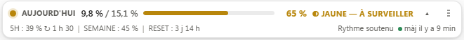
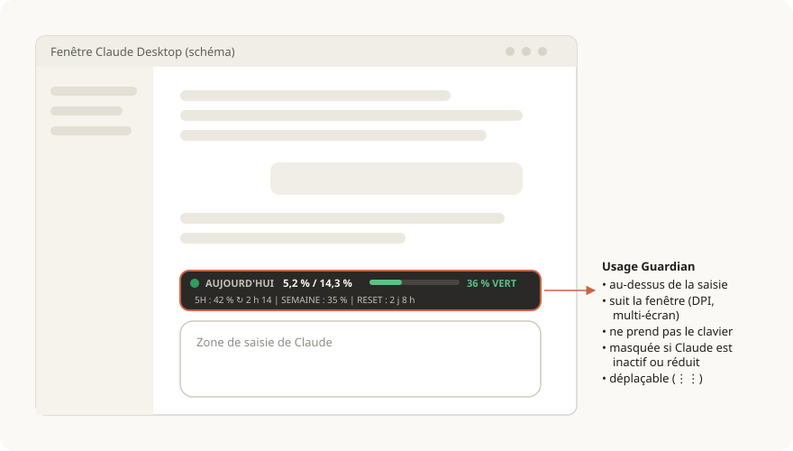
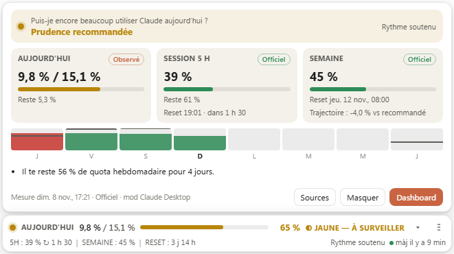
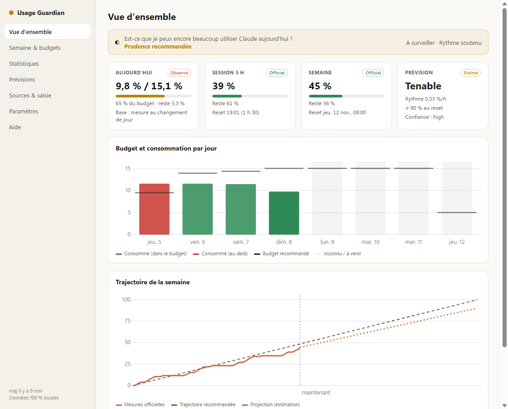
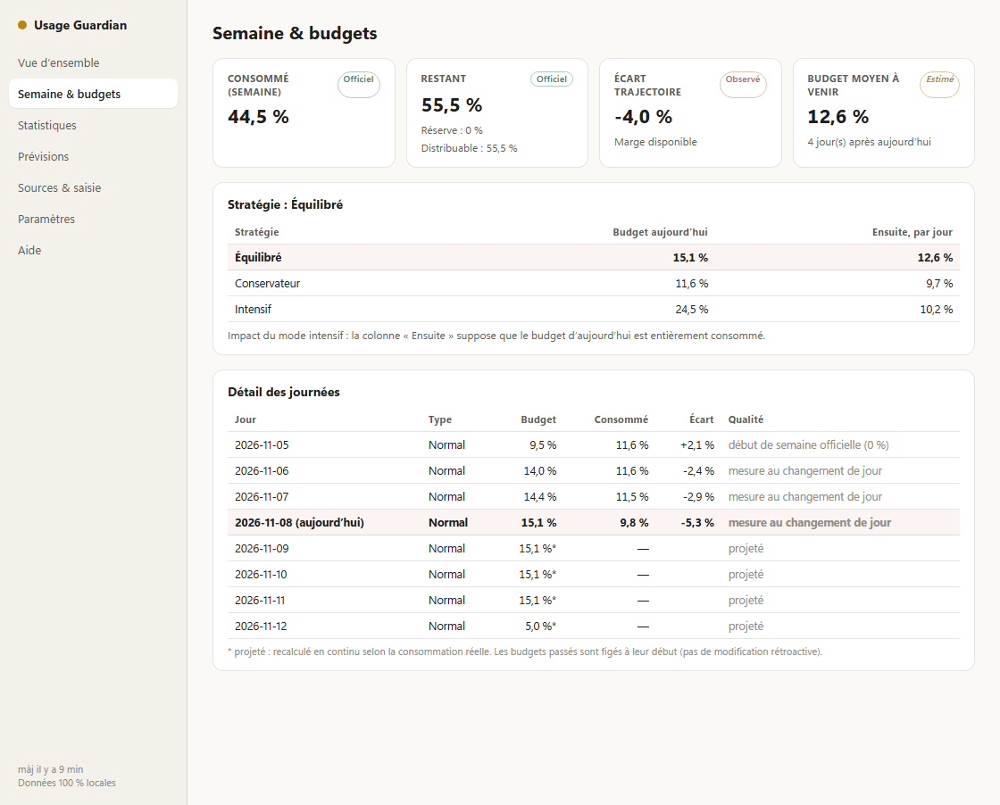
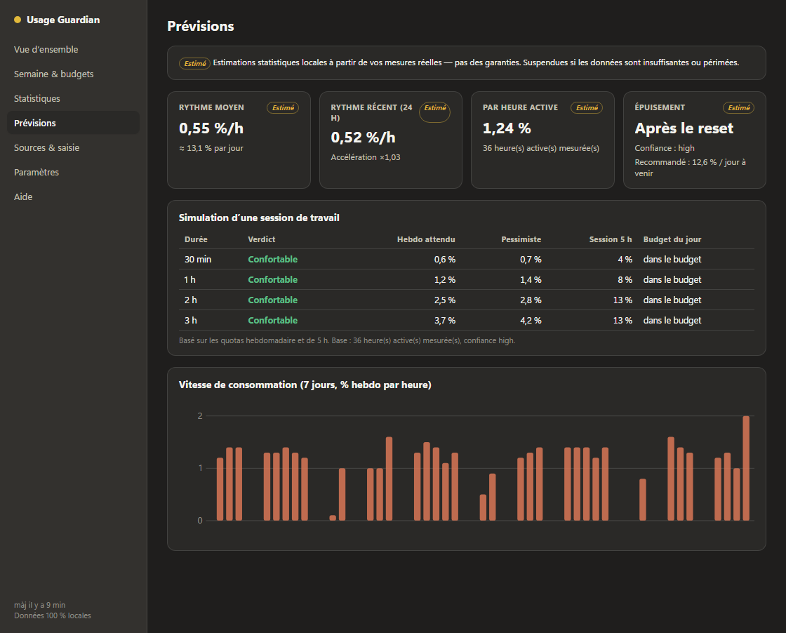
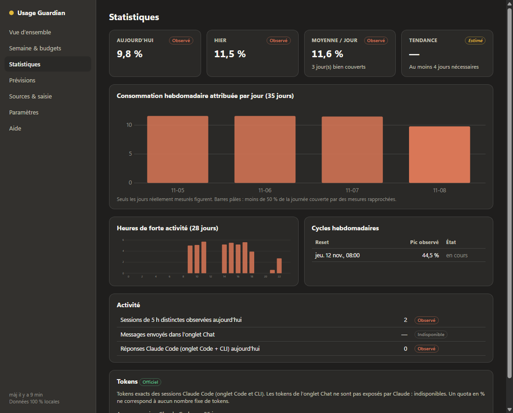
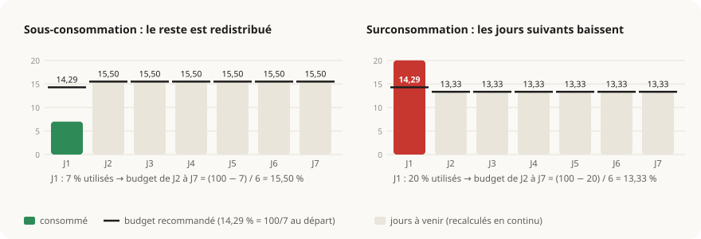
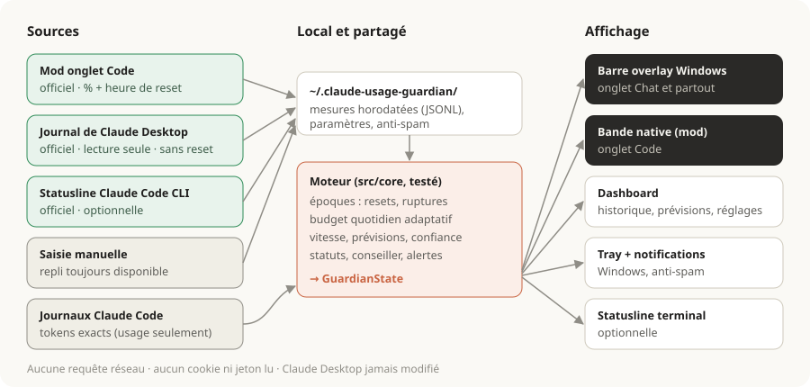

# Usage Angel Guardian — Claude Desktop Usage Guardian

**Transformez votre quota hebdomadaire Claude en budget quotidien intelligent, affiché directement dans Claude Desktop (Windows).**

    

<picture>
  <source media="(prefers-color-scheme: dark)" srcset="docs/images/bar-dark.png">
  
</picture>

Claude vous donne un quota **hebdomadaire**. Usage Guardian le transforme en budget **quotidien** :
- ce que vous n'utilisez pas aujourd'hui est redistribué sur les jours suivants ;
- si vous dépassez, les jours suivants baissent ;
- la barre vous dit en un coup d'œil si vous pouvez encore beaucoup utiliser Claude aujourd'hui.

> Les captures de ce README utilisent des **données simulées**.

---

## Sommaire

1. [Aperçu](#aperçu)
2. [Fonctionnalités](#fonctionnalités)
3. [Installation](#installation)
4. [Utilisation](#utilisation)
5. [Comment ça marche](#comment-ça-marche)
6. [Personnaliser et modifier](#personnaliser-et-modifier)
7. [Confidentialité](#confidentialité-et-sécurité)
8. [Limites connues](#limites-connues)
9. [Développement](#développement)

---

## Aperçu

### Intégrée à la fenêtre Claude



La barre suit la fenêtre Claude : déplacement, redimensionnement, plusieurs écrans, mise à l'échelle DPI. Elle ne s'affiche que quand Claude est au premier plan et ne prend jamais le focus du clavier.

### Panneau détaillé (un clic)

<picture>
  <source media="(prefers-color-scheme: dark)" srcset="docs/images/panel-dark.png">
  
</picture>

### Dashboard complet

| Vue d'ensemble | Semaine et budgets |
|---|---|
|  |  |
| **Prévisions et simulation de session** | **Statistiques** |
|  |  |

Thèmes clair et sombre automatiques (versions sombres et claires de chaque capture dans [`docs/images`](docs/images)).

---

## Fonctionnalités

| | |
|---|---|
| **Budget du jour adaptatif** | Basé sur votre semaine officielle réelle (heure de reset exacte, jours partiels, changements d'heure), fuseau et heure de début de journée réglables. |
| **3 stratégies** | *Équilibré* (défaut), *Conservateur* (réserve de 10 à 20 %), *Intensif* (plus aujourd'hui, avec l'impact visible sur les jours suivants). Jours de repos et de forte activité. |
| **Limites officielles** | Session 5 h et semaine : %, reste, compte à rebours, projection. Quotas par modèle s'ils sont fournis. |
| **Vitesse** | Signale une consommation dangereusement rapide, même avant la fin du budget. |
| **Conseiller** | « Puis-je encore beaucoup utiliser Claude aujourd'hui ? » : *Liberté élevée* → *Budget dépassé*, sans nombre de messages inventé. |
| **Prévisions** | Rythme moyen et récent, accélération, date d'épuisement, niveau de confiance. Simulation d'une session de 30 min à 3 h. |
| **Statistiques** | Historique, heures actives, cycles hebdomadaires, tokens exacts Claude Code par jour, modèle et session. Export CSV/JSON. |
| **Notifications Windows** | 80 % du budget, dépassement, rythme excessif, quota presque épuisé, reset. Anti-spam et mode silencieux. |
| **Icône près de l'horloge** | Jauge colorée, menu : barre, dashboard, actualiser, paramètres, démarrage avec Windows, quitter. |
| **Transparence** | Chaque valeur porte un badge : **Officiel**, **Observé**, **Estimé** ou **Indisponible**, plus l'âge de la dernière mesure. |

---

## Installation

### Prérequis
- Windows 10 ou 11, [Claude Desktop](https://claude.ai/download) (installation Microsoft Store/MSIX ou classique).
- Un abonnement Pro, Max ou Ultra (les quotas en % n'existent pas pour les comptes API).
- Pour construire : [Node.js](https://nodejs.org) 18 ou plus récent et Git.

### 1. Construire et installer l'application

```bash
git clone https://github.com/lucagslr/usage-angel-guardian.git
cd usage-angel-guardian
npm install
npm run dist
```

Ensuite, lancez `release\Claude-Desktop-Usage-Guardian-Setup-0.1.0.exe` : installation pour votre compte, sans droits administrateur. Comme l'exécutable n'est pas signé, SmartScreen avertit : cliquer sur *Informations complémentaires*, puis *Exécuter quand même*. Une version portable est aussi produite dans `release\`.

Pour essayer sans installer : `npm start`.

### 2. Activer la source de mesures officielles (recommandé)

L'application a besoin du % hebdomadaire **et** de l'heure de reset. La source la plus fiable est le **mod** fourni pour l'onglet **Code** de Claude Desktop :

```
/plugin marketplace add lucagslr/usage-angel-guardian
/plugin install usage-guardian@claude-desktop-usage-guardian
/reload-plugins
```

Après la réponse suivante de Claude, le mod enregistre les limites officielles, l'overlay les lit, et une bande native apparaît au-dessus de la saisie de l'onglet Code (`/guardian` ouvre le détail).

**Sans le mod**, deux autres possibilités :
- recopier une fois le % et l'heure de reset dans *Dashboard › Sources & saisie* ;
- se contenter du journal local de Claude Desktop, mis à jour plus rarement.

### 3. Optionnel
- **Démarrage avec Windows** : clic droit sur l'icône › *Lancer avec Windows*.
- **Statusline Claude Code CLI** : `npm run statusline:install`. Cette commande ne modifie rien et affiche seulement la configuration ; ajoutez `-- --apply` pour l'appliquer, avec sauvegarde de `~/.claude/settings.json`.

Guide détaillé, mise à jour et désinstallation : [docs/INSTALL.md](docs/INSTALL.md).

---

## Utilisation

### Lire la barre

```
● AUJOURD'HUI 5,2 % / 14,3 %  ███████░░░░░░░░░░░ 36 %  ● VERT — UTILISATION MAÎTRISÉE   ▴ ⋮⋮
5H : 42 % ↻ 2 h 14 | SEMAINE : 35 % | RESET : 2 j 8 h | rythme calme | màj il y a 3 min
```

- **5,2 % / 14,3 %** : part du quota hebdomadaire consommée aujourd'hui, comparée au budget recommandé du jour.
- **▴** ouvre le panneau, **⋮⋮** déplace la barre (double-clic : position par défaut).
- **◔** indique une journée suivie partiellement ; **RESET\*** une heure de reset déduite.


La couleur est toujours accompagnée d'une icône et d'un texte. Les seuils sont réglables. Rien n'est jamais bloqué : ce sont des recommandations.

### Le budget s'adapte chaque jour



Le budget d'un jour est figé à son début : pas de cible qui bouge pendant la journée, ni de réécriture des jours passés. Les jours suivants, eux, sont recalculés en continu. Formules complètes : [docs/BUDGET_MATH.md](docs/BUDGET_MATH.md).

Guide complet de l'interface : [docs/USAGE.md](docs/USAGE.md).

---

## Comment ça marche



| Source | Statut | Ce qu'elle apporte |
|---|---|---|
| Mod onglet Code (`session.measure`) | Officiel | % 5 h et hebdo **avec heure de reset**, après chaque réponse d'une session Code |
| `%APPDATA%\Claude\plan-usage-history.json` | Officiel (lecture seule) | % écrits par Claude Desktop lui-même, sans heure de reset |
| Statusline Claude Code CLI | Officiel (optionnel) | `rate_limits` documentés |
| Saisie manuelle | Manuel | Repli toujours disponible |
| Journaux `~/.claude/projects` | Officiel, local | Tokens exacts (champs `usage` uniquement) |

**Pourquoi un overlay et un mod plutôt qu'une modification de Claude Desktop ?** L'installation MSIX est signée : la modifier (patch d'`app.asar`, injection) briserait l'intégrité et sauterait à chaque mise à jour. Le mod utilise l'API officielle des plugins. L'overlay se contente d'observer la position de la fenêtre (Win32 en lecture seule).

Détails : [docs/ARCHITECTURE.md](docs/ARCHITECTURE.md) · [docs/DATA_SOURCES.md](docs/DATA_SOURCES.md) · [docs/DECISION.md](docs/DECISION.md)

---

## Personnaliser et modifier

Sans toucher au code, depuis *Dashboard › Paramètres* : stratégie, réserves, jours de repos, fuseau, début de journée, seuils, emplacement, taille et thème de la barre, notifications, rétention.

Pour modifier le code :

| Je veux changer… | Fichier |
|---|---|
| Les valeurs par défaut (seuils, réserve, fuseau…) | `src/core/settings.ts` |
| Le calcul du budget ou une nouvelle stratégie | `src/core/budget.ts` (+ tests dans `tests/budget.test.ts`) |
| Les messages et conseils | `src/core/alerts.ts` |
| Les couleurs et le style | `src/app/renderer/theme.css`, `overlay.css`, `dashboard.css` |
| Le contenu de la barre ou du panneau | `src/app/renderer/overlay.ts` |
| La position par défaut au-dessus de la saisie | `INPUT_INSET` dans `src/app/main/layout.ts` |
| Ajouter une source de données | `src/core/normalize.ts` + `src/sources/` |
| La bande de l'onglet Code | `mod/src/register.tsx`, puis `npm run build` |

Pas à pas, exemples et bonnes pratiques : **[docs/CUSTOMIZE.md](docs/CUSTOMIZE.md)**.

---

## Confidentialité et sécurité

- **100 % local** : aucune requête réseau, aucune télémétrie, aucun serveur.
- **Aucun secret lu** : ni cookies, ni jetons OAuth, ni mots de passe.
- **Aucun contenu de conversation** lu ou stocké.
- **Claude Desktop jamais modifié**, pas de droits administrateur.
- Données dans `%USERPROFILE%\.claude-usage-guardian`, exportables et supprimables. Le désinstalleur demande si vous voulez les conserver.

Détails : [docs/SECURITY.md](docs/SECURITY.md).

## Limites connues

- Pas de mesure en direct si vous n'utilisez que l'onglet Chat : le mod (onglet Code) ou la saisie manuelle apportent l'heure de reset.
- La position de la zone de saisie est estimée : ajustez-la avec ⋮⋮.
- Tokens indisponibles pour l'onglet Chat ; environ 130 à 210 Mo de mémoire (Electron).

Liste complète : [docs/LIMITATIONS.md](docs/LIMITATIONS.md) · Problème ? [docs/TROUBLESHOOTING.md](docs/TROUBLESHOOTING.md)

---

## Développement

```bash
npm install
npm run check          # typecheck + 68 tests + build
npm start              # overlay en développement
npm run demo -- C:\tmp\demo-data   # données simulées, puis CUG_DATA_DIR=C:\tmp\demo-data npm start
npm run dist           # installateur NSIS + exécutable portable
```

TypeScript, Electron et [koffi](https://koffi.dev) (Win32), vitest. Interface sans framework (DOM et SVG). Moteur pur et partagé (`src/core`) entre l'overlay, le mod et la statusline.

## Licence

MIT. Projet indépendant, **non affilié à Anthropic**. « Claude » est une marque d'Anthropic.
